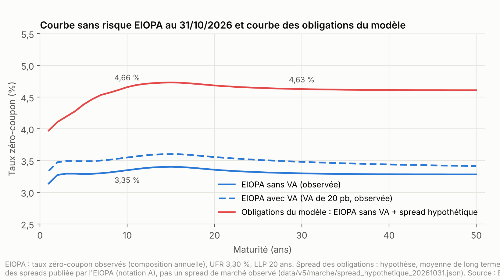
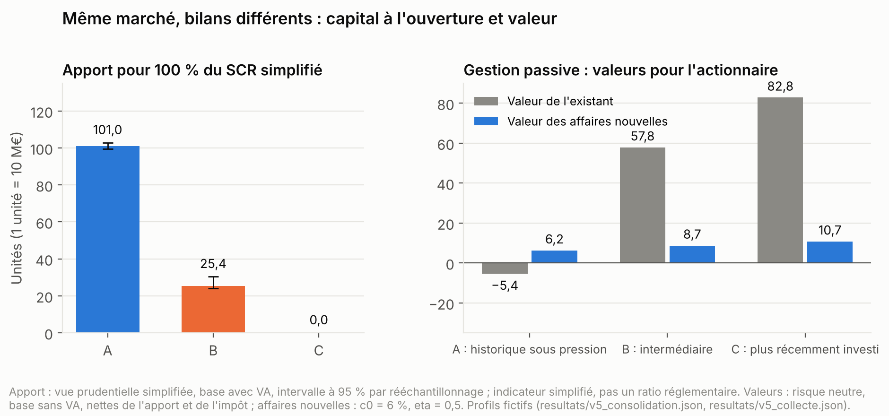
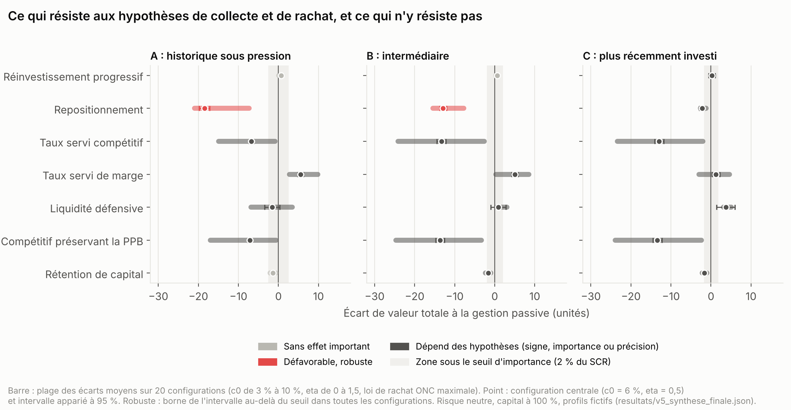
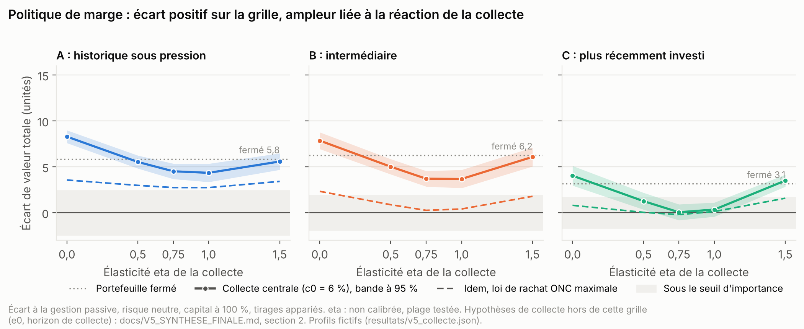
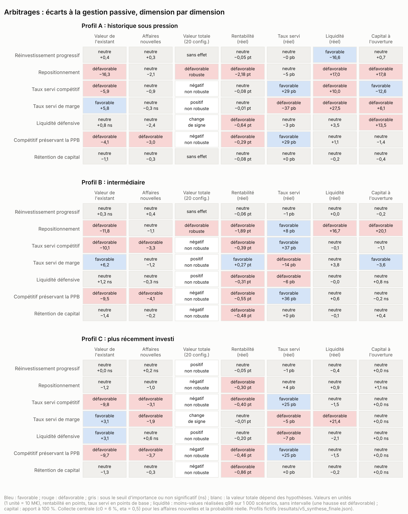
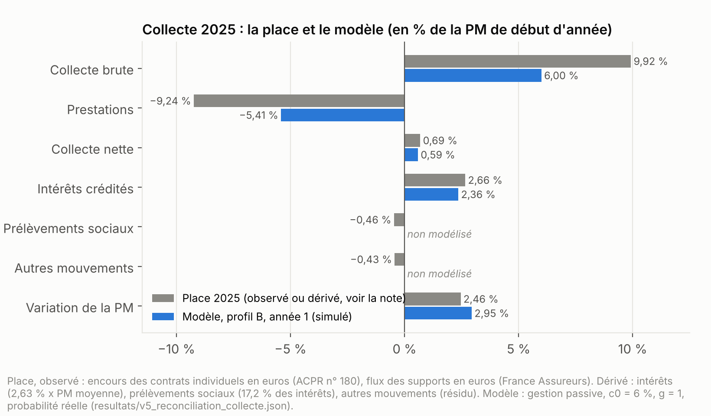
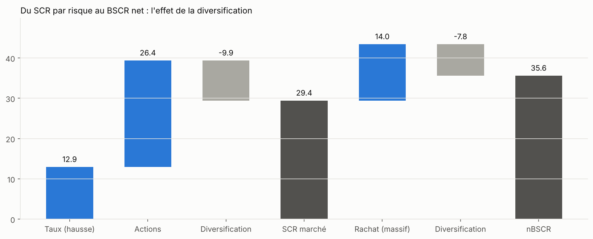
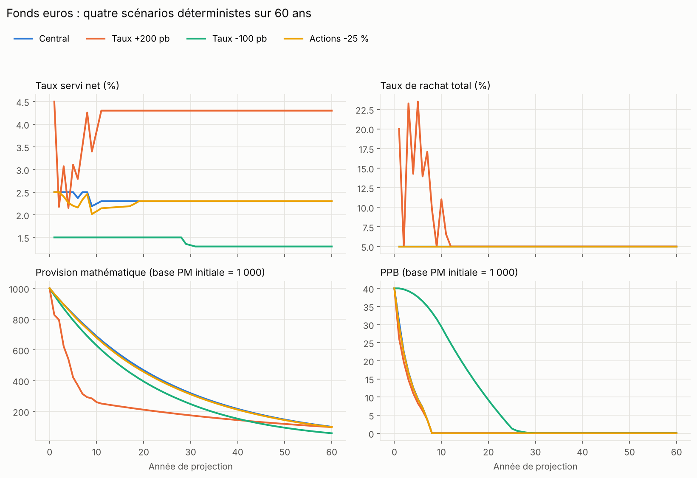
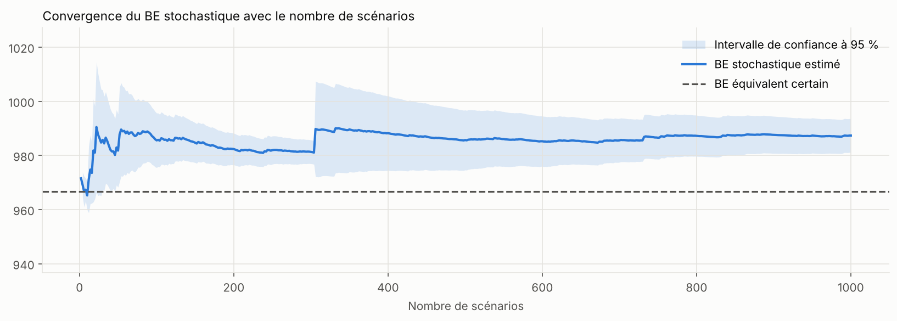
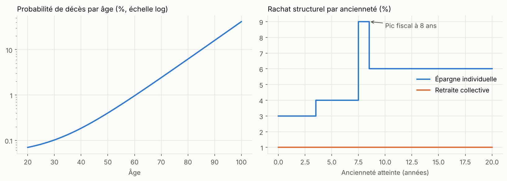

# Mini-modèle ALM fonds euros

[](https://github.com/TorjmenYou/mini-alm-fonds-euros/actions/workflows/tests.yml)

[](LICENSE)

Projet pédagogique : un modèle actif-passif simplifié d'un fonds euros d'assurance vie, codé en Python pour rendre visible la mécanique d'un modèle ALM. Les versions V1 à V4 construisent le moteur : projection déterministe, Best Estimate stochastique, bilan Solvabilité II simplifié, passif « à la Prophet ». La V5 s'en sert pour une étude économique : comment la même décision de gestion produit des effets différents selon le bilan de l'assureur, sur les données de marché de fin octobre 2026 (courbe EIOPA du 31/10/2026). Les résultats ci-dessous sont ceux de la V5.1 (novembre 2026), qui corrige la participation aux bénéfices de la V5.0 et remplace le spread de marché des obligations par une hypothèse construite à partir de paramètres publiés par l'EIOPA : voir [l'audit des conventions](docs/V5_AUDIT_CONVENTIONS.md).

> **Usage.** Ce modèle sert à démontrer et à expliquer des mécanismes. Ce n'est pas un outil de calcul prudentiel ni une recommandation de gestion. Les assureurs de la V5 sont fictifs. Les indicateurs Solvabilité II calculés ici sont simplifiés (modules absents, pas de mesure transitoire) : ce ne sont pas des ratios réglementaires. Voir les limites de la [V5](#ce-que-létude-ne-permet-pas-de-conclure) et du [socle V1 à V4](#limites-du-socle-v1-à-v4).

**Documentation :**
- [Méthodologie V1 à V4](docs/METHODOLOGIE.md) et [contrôles, limites et corrections](docs/CONTROLES_ET_LIMITES.md).
- [Synthèse économique de la V5](docs/V5_SYNTHESE_FINALE.md), [audit des conventions et corrections de la V5.1](docs/V5_AUDIT_CONVENTIONS.md), [registre des hypothèses](docs/V5_HYPOTHESES.md), [reproduction et traçabilité](docs/V5_REPRODUCTION.md) ; liste complète des documents V5 [plus bas](#documents-de-la-v5).

## V5 : trois assureurs fictifs, huit stratégies, un même marché

### La question

Une même courbe des taux, au 31/10/2026, s'impose à tous les assureurs. Elle ne suffit pas à choisir une stratégie ALM. Vendre des obligations anciennes pour réinvestir aux taux du marché, relever le taux servi, réduire le risque, préserver la PPB, retenir du capital : chacune de ces décisions paraît rationnelle, mais son effet économique dépend du portefeuille hérité, des garanties, des réserves et du capital de l'assureur qui la prend.

La V5 compare donc **huit stratégies** sur **trois profils fictifs** d'assureur-vie, construits pour différer par leur passé et non par leur marché :

| Profil | Bilan à l'ouverture | Indicateur de couverture simplifié du SCR, sans apport |
| --- | --- | ---: |
| **A**, historique sous pression | obligations achetées surtout entre 2015 et 2021 à faibles coupons, fortes moins-values latentes, réserves en partie consommées, garanties plus élevées | 13 % |
| **B**, intermédiaire | générations d'obligations mélangées, réserves et taux servi proches des ordres de grandeur de place | 74 % |
| **C**, plus récemment investi | portefeuille constitué surtout depuis 2022, coupons plus élevés, contrats sans taux garanti | 104 % |

Les stratégies : gestion passive (règles des V1 à V4, taux servi visé 0,5 point sous la référence des assurés), réinvestissement progressif sur une échelle de maturités, repositionnement obligataire (vente de 25 % des obligations à l'ouverture), politique de taux servi compétitive, politique de marge, politique compétitive préservant la PPB, gestion défensive de la liquidité, rétention de capital ([détail](docs/V5_HYPOTHESES.md#5-stratégies-alm-et-règles-de-lecture-fictives)).

### Comment les stratégies sont comparées

- **Même marché.** Courbe sans risque EIOPA du 31/10/2026 (observée, empreinte de l'archive conservée) ; obligations détenues valorisées au-dessus de cette courbe avec un **spread hypothétique** : la moyenne de long terme des spreads publiée par l'EIOPA pour les obligations notées A, notation la plus représentée du portefeuille des assureurs, et non un spread de marché observé à cette date ; générateur de scénarios calé sur la courbe.
- **Participation aux bénéfices (V5.1).** Compte de participation simplifié des articles A.132-11 et A.132-12 du Code des assurances : 85 % de la quote-part des produits financiers et 90 % du solde technique créditeur (chargements moins frais) ; la participation de l'exercice ne descend pas sous ce compte. La V5.0 publiée le 07/11/2026 ne retenait que la part financière : à capital et marché identiques, la correction baisse la valeur de l'existant de 2,2 (A), 7,0 (B) et 10,6 (C) ([audit](docs/V5_AUDIT_CONVENTIONS.md)).
- **Même règle de capital.** Chaque stratégie reçoit l'apport qui porte son propre indicateur de couverture simplifié du SCR à 100 %, calculé dans la vue prudentielle sur la base avec VA (correction pour volatilité), comme dans la pratique réglementaire. Sa valeur est nette de cet apport : un apport de capital n'est jamais compté comme un profit.
- **Deux mesures séparées.** La valeur pour l'actionnaire est mesurée en risque neutre, sur la base sans VA (valeur économique), nette de l'impôt. La rentabilité, les dividendes, le taux servi, les rachats et la liquidité sont mesurés en probabilité réelle, sans être combinés à la valeur. La correction pour volatilité n'intervient que dans la vue prudentielle : c'est un effet réglementaire, pas de la valeur économique.
- **Mêmes tirages.** Toutes les stratégies voient les mêmes scénarios économiques et les mêmes défauts de crédit. Chaque écart de valeur à la gestion passive porte un intervalle de confiance apparié à 95 %, et l'apport nécessaire un intervalle de rééchantillonnage ; les indicateurs en probabilité réelle (rentabilité, taux servi, liquidité) sont lus sans intervalle.
- **Lecture fixée à l'avance.** Un écart est *significatif* si son intervalle apparié à 95 % exclut zéro, *important* s'il est significatif et si sa moyenne dépasse 2 % du SCR simplifié du profil, *robuste* si la borne de l'intervalle dépasse ce seuil, avec le même signe, dans toutes les configurations de la grille (20 par profil). Un changement de signe n'est retenu que s'il repose sur des écarts significatifs de part et d'autre. Les intervalles sont calculés cellule par cellule et ne sont pas simultanés : « robuste » est un critère descriptif, interne à la grille testée.
- **Collecte nouvelle.** Le portefeuille fermé est complété par une collecte sensible au taux servi relatif : C(t) = c0 x PM(t - 1) x g(e), avec e l'écart du taux servi sur les contrats nouveaux à la référence des assurés. L'intensité centrale c0 = 6 % est dérivée de la collecte nette de 2025, une seule année ; les intensités de 3 % et 10 % et l'élasticité eta (de 0 à 1,5) sont fictives. Elles forment une grille de 15 configurations, complétée par la loi de rachat ONC maximale, soit 20 configurations par profil ; e0 et l'horizon de collecte sont testés à part. La vue prudentielle simplifiée est calculée sur l'existant en extinction, sans primes ni contrats futurs (frontière des contrats) ; les effets de la collecte sur les hypothèses de projection de l'existant sont analysés à part, dans la vue économique, alors qu'un calcul Solvabilité II complet peut devoir en tenir compte.



### Ce que montrent les simulations

**1. Le bilan hérité conditionne fortement le capital nécessaire et la valeur, avant toute stratégie.** Sur le même marché, l'apport estimé pour porter l'indicateur simplifié à 100 % est de 101,0 pour A et 25,4 pour B, en unités de 10 M€ ; C couvre déjà son SCR simplifié sans apport (gestion passive ; intervalles à 95 % dans la synthèse ; estimations visant 100 %, pas des montants réglementaires). L'existant de A a une valeur à peine positive pour l'actionnaire avant recapitalisation (4,5), et recapitaliser à 100 % lui coûte 9,9 (impôt et participation sur les revenus du capital apporté) : −5,4 une fois recapitalisé, contre 57,8 pour B et 82,8 pour C. La valeur des affaires nouvelles est faible en comparaison : 6,2 à 10,7 en collecte centrale (c0 = 6 %, eta = 0,5), soit environ 3 % de la valeur actuelle des primes, et de 0,3 à 34,1 sur toute la grille. La variation d'impôt représente 46 % à 49 % de la valeur avant impôt, bien plus que le taux nominal de l'impôt sur les sociétés ; l'origine de cet écart n'est pas entièrement isolée. C'est une valeur avant coût explicite de mobilisation du capital additionnel : une charge frictionnelle de 2,0 % à 2,5 % par an d'un capital proxy (SCR proportionnel au surcroît de PM dû à la collecte) suffirait à l'annuler en collecte centrale (analyse de seuil, aucun coût retenu).



**2. Sur la grille de collecte et de rachat, peu de conclusions sont robustes, et ce sont des désavantages.** Sur les 20 configurations de chaque profil :
- le **repositionnement obligataire** est défavorable et robuste pour A et B : vendre 25 % des obligations à l'ouverture réalise des moins-values, qui passent par la réserve de capitalisation puis par le résultat, et augmente le capital nécessaire (+17,8 pour A, +20,1 pour B) ; pour C, dont le portefeuille est récent, l'écart est plus petit : négatif partout, important dans 16 configurations sur 20, non robuste, avec un capital d'ouverture un peu plus élevé (+1,1) ;
- les **politiques compétitives** (taux servi visé égal à la référence, avec ou sans préservation de la PPB) réduisent la valeur dans toutes les configurations des trois profils, sans être robustes : pour A, l'écart n'est important que dans 15 configurations sur 20 ; pour B et C, il est important dans 19 ou 20 configurations, mais la borne de son intervalle passe sous le seuil dans 1 à 5 configurations ; avec les hypothèses de collecte testées à part (e0, horizon), elles ne sont pas plus robustes, en partie à cause de cellules très imprécises ;
- le **réinvestissement progressif** n'a pas d'effet important ; la **rétention de capital** réduit un peu la valeur de B et C (important dans 1 et 4 configurations sur 20) ;
- **aucune stratégie n'a d'avantage robuste**, et aucune n'est désignée optimale.



**3. La politique de marge : un écart positif pour A et B, un changement de signe pour C, jamais robuste.** Viser 1 point sous la référence, au lieu de 0,5, augmente la valeur pour l'actionnaire dans les 20 configurations de A et de B ; pour C, l'écart est positif dans 16 configurations sur 20 et significativement négatif dans 2 (de −3,0 à 9,8 selon le profil et la configuration). Deux mécanismes mesurés expliquent l'avantage : en probabilité réelle, le taux servi ne baisse que de 5 à 37 pb en moyenne sur 10 ans, car la participation minimale et les reprises de PPB amortissent la baisse ; la marge des affaires nouvelles est mince (environ 3 % de la valeur actuelle des primes), si bien que la collecte perdue coûte peu. Mais l'ampleur de l'avantage dépend de l'élasticité, qui n'est pas calibrée, et la borne de son intervalle passe sous le seuil d'importance dans 6 (A), 8 (B) et 13 (C) configurations sur 20. Avec e0 = −0,5 point (la collecte « normale » est atteinte en servant 0,5 point sous la référence), un écart de C devient nettement négatif (−7,1 ± 3,4, à c0 = 10 %). Le modèle ignore en outre l'effet commercial et de réputation d'un taux servi durablement inférieur à la référence (−26 à −93 pb en moyenne sur 10 ans, probabilité réelle).



**4. Chaque stratégie déplace la valeur, la rentabilité, le taux servi, la liquidité et le capital dans des sens différents.** La politique de marge gagne de la valeur (sauf dans quelques configurations de C) mais dégrade le taux servi et, pour A et C, la liquidité (quantile à 99 % des moins-values réalisées, estimé sur 1 000 scénarios sans intervalle) ; la politique compétitive améliore le taux servi et réduit le capital nécessaire à l'ouverture de A, mais réduit la valeur dans toutes les configurations ; la liquidité défensive réduit la rentabilité de A et B sans gain de valeur robuste. La matrice ci-dessous lit chaque dimension séparément, avec ses propres seuils.



**5. La collecte modifie aussi les besoins de capital futurs, estimés ici par un simple ordre de grandeur.** À SCR proportionnel à la PM (ordre de grandeur, pas une projection), la croissance demanderait à 10 ans, pour la gestion passive, un SCR supplémentaire de 12 à 67 unités selon le profil et l'élasticité, à comparer à l'apport d'ouverture (101,0 pour A, 25,4 pour B, aucun pour C). La politique de distribution retient en même temps des fonds propres comptables (+28 à +62 à 10 ans, médianes, eta = 0,5) : ce SCR n'appelle donc pas un apport du même montant, mais fonds propres comptables et prudentiels ne coïncident pas. Pour plusieurs stratégies, l'écart de capital à l'ouverture et l'écart de capital de la croissance vont en sens contraire. **Aucune stratégie ne garantit la conformité prudentielle future** : le SCR n'est pas projeté.

**6. L'intensité centrale de collecte donne un ordre de grandeur proche de la collecte nette de 2025, pas de ses flux bruts.** Avec c0 = 6 %, le modèle donne une collecte nette de 0,59 % de la PM la première année, malgré des différences de périmètre et de flux, contre 0,69 % pour la place en 2025 (collecte nette des supports en euros rapportée à l'encours des contrats individuels en euros). Les flux bruts du modèle sont plus faibles que ceux de la place, et le modèle n'a ni prélèvements sociaux ni arbitrages : sa PM croît un peu plus vite.



### Ce que l'étude ne permet pas de conclure

- **Comportement des assurés.** Aucune donnée vérifiée ne calibre l'élasticité de la collecte ni la loi de rachat en 2026 ; la loi centrale vient des V1 à V4, les corridors ONC de 2013 servent de sensibilité. La perte de compétitivité ne fait pas racheter l'existant au-delà de cette loi.
- **Capital futur.** Le besoin de capital est mesuré à l'ouverture, sur l'existant en extinction ; le capital de la croissance n'est qu'un ordre de grandeur ; fonds propres comptables et prudentiels ne coïncident pas.
- **Vue prudentielle.** Indicateurs simplifiés, sur la base avec VA : risque opérationnel par la seule formule sur provisions, pas de mesure transitoire, ni contrepartie, concentration, immobilier ou change ; impôts différés actifs non reconnus. Calculée en extinction ; la réserve de capitalisation suit le principe de l'article R.351-2-1 du Code des assurances (mouvements pris en compte dans le BE, solde final en fonds propres) sans en reproduire toutes les modalités.
- **Valeur des affaires nouvelles.** Hors Solvabilité II, avant coût explicite de mobilisation du capital additionnel. Seuls les coûts frictionnels du capital comptable retenu (impôt et participation sur ses revenus) sont déduits ; le coût du capital immobilisé pour le SCR supplémentaire n'est mesuré que par un seuil, et aucune marge pour risques non couvrables n'est déduite. Le cas de contrôle sans marge explicite garde un petit résidu, expliqué par les conventions de partage et de liquidation du modèle.
- **Lecture statistique.** Intervalles à 95 % par cellule, non simultanés : sur l'ensemble des comparaisons, quelques écarts peuvent paraître significatifs par hasard. Les quantiles à 99 % de liquidité reposent sur une dizaine de scénarios et n'ont pas d'intervalle.
- **Mécanismes absents.** Inflation et attractivité du taux servi réel, arbitrages entre fonds euros et unités de compte, migration de notation des obligations, comportement de rachat propre aux contrats nouveaux, distribution fondée sur la couverture du SCR : chacun peut modifier le classement des politiques de taux servi.
- **Données de marché.** Seule la courbe sans risque EIOPA est observée. Le spread des obligations est une hypothèse de niveau « normal », hors période de tension : les niveaux de valeur, de capital et de moins-values latentes en dépendent ; les comparaisons de stratégies partagent le même marché ([audit](docs/V5_AUDIT_CONVENTIONS.md), section 3). Aucune donnée d'indice de taux de l'État n'est utilisée ni redistribuée.
- **Participation aux bénéfices.** Compte de participation simplifié (un seul canton, ni résultat de mortalité ni réassurance) ; l'ampleur de la composante technique dépend des frais de gestion, fictifs. **Impôt** calculé après coup : les dividendes et fonds propres de la projection sont avant impôt (une variante qui le paie chaque année ne change la valeur que de moins de 1 %).
- **Profils.** Fictifs : leurs ordres de grandeur sont confrontés aux publications de place, mais ils ne décrivent aucun organisme et ne calibrent aucune moyenne de marché.

### Données et hypothèses

Chaque paramètre porte le statut écrit dans les fichiers de données : **observé** (courbe EIOPA et moyennes de long terme des spreads publiées par l'EIOPA, taux servi moyen, chargements, rachats et encours de place), **calibré ou dérivé d'observations par une règle écrite** (rachat structurel converti du taux ACPR, intensité centrale de collecte), **hypothèse** (spread des obligations détenues, coupons par génération, forme des pertes de crédit, référence des assurés) ou **fictif** (bilans des profils, stratégies, autres intensités, élasticités, seuils de lecture) ; certaines lignes précisent une variante (sensibilité, stress, source secondaire). Le [registre des hypothèses](docs/V5_HYPOTHESES.md) recopie les paramètres de `data/` avec leur statut et leur source.

**Résultats observés, paramètres fictifs et résultats simulés ne sont jamais confondus** : les tableaux et figures indiquent la nature de chaque chiffre.

### Reproduire les résultats

```bash
pip install -r requirements-dev.txt               # dépendances du projet et des tests
python -m pytest                                  # 311 tests, dont la concordance des documents avec les résultats
python scripts/v5_documents.py                    # régénère documents et figures depuis resultats/*.json
python scripts/v5_verifier_reproduction.py        # recalcule sans cache un échantillon de 17 résultats (environ 2 minutes)
```

Les calculs complets (environ 2 h 40 pour la consolidation, 1 h 35 pour la collecte, sur 2 cœurs) et la traçabilité de chaque figure et de chaque chiffre clé sont décrits dans [docs/V5_REPRODUCTION.md](docs/V5_REPRODUCTION.md).

### Documents de la V5

| Document | Contenu |
| --- | --- |
| [V5_SYNTHESE_FINALE.md](docs/V5_SYNTHESE_FINALE.md) | Synthèse économique : ce que l'étude établit, politique de marge, tableaux par profil, limites |
| [V5_AUDIT_CONVENTIONS.md](docs/V5_AUDIT_CONVENTIONS.md) | Audit de la V5.0 : participation aux résultats (correction de la V5.1), données de marché (spread hypothétique de la V5.1), impôt dans la projection, précision des apports ; comparaison avant/après |
| [V5_SPECIFICATION_COLLECTE.md](docs/V5_SPECIFICATION_COLLECTE.md) | Spécification du modèle de collecte nouvelle : collecte, fonds mutualisé, mesures de valeur, interactions entre générations, absence d'arbitrage |
| [V5_COLLECTE.md](docs/V5_COLLECTE.md) | Collecte nouvelle : réconciliation 2025, contrat sans marge explicite et variantes de liquidation, valeur des affaires nouvelles, huit stratégies, capital de la croissance, seuil de coût du capital |
| [V5_STRATEGIES.md](docs/V5_STRATEGIES.md) et [V5_SYNTHESE_STRATEGIES.md](docs/V5_SYNTHESE_STRATEGIES.md) | Portefeuille fermé : vue prudentielle, capital nécessaire, comparaison des stratégies sur une base de capital commune |
| [V5_CONVENTIONS.md](docs/V5_CONVENTIONS.md) et [V5_SYNTHESE_AVANT_OPTIMISATION.md](docs/V5_SYNTHESE_AVANT_OPTIMISATION.md) | Conventions de crédit, de référence des assurés et de rachat, comparées avant toute stratégie |
| [V5_BILANS_INITIAUX.md](docs/V5_BILANS_INITIAUX.md) | Bilans comptables et économiques d'ouverture, réconciliations, absence d'arbitrage |
| [V5_METHODOLOGIE.md](docs/V5_METHODOLOGIE.md) | Conventions : valeur de marché, risque neutre, probabilité réelle, coûts du capital, impôt, collecte |
| [V5_HYPOTHESES.md](docs/V5_HYPOTHESES.md) | Registre des données et des hypothèses, avec statut et source |
| [V5_REPRODUCTION.md](docs/V5_REPRODUCTION.md) | Reproduction des résultats, ordre des calculs, traçabilité des figures et des chiffres |

Tous ces documents, sauf la méthodologie, la spécification de la collecte et la reproduction, sont générés par des scripts à partir des résultats : aucun chiffre n'y est saisi à la main. Les chiffres de ce README et de `V5_REPRODUCTION.md` sont rédigés à la main ; un test (`tests/test_v5_readme.py`) vérifie les principaux contre les résultats.

## Socle V1 à V4

Le moteur des V1 à V4 est conservé tel quel : la V5 l'appelle avec ses propres données et conventions, et un test vérifie que les résultats publiés des V1 à V4 sont inchangés.

Les V1 à V4 forment un modèle actif-passif (ALM) simplifié d'un fonds euros d'assurance vie. Ils couvrent la chaîne complète :
- projection du fonds ;
- valorisation des engagements envers les assurés (Best Estimate) ;
- coût des options et garanties (TVOG) ;
- bilan Solvabilité II simplifié ;
- réécriture du passif à la manière d'un outil de modélisation actuarielle comme Prophet.

### Pourquoi ce modèle

Un fonds euros garantit le capital des assurés et leur reverse une partie des produits financiers de l'assureur. Pour piloter ce fonds, l'assureur doit répondre à trois questions :

| Question | Ce que le modèle calcule |
| --- | --- |
| Combien valent mes engagements envers les assurés, dans tous les scénarios de marché ? | Best Estimate stochastique |
| Combien me coûtent les garanties et le droit de rachat des assurés ? | TVOG et sa décomposition |
| Combien de capital dois-je détenir face aux chocs de marché et de rachat ? | SCR simplifié et marge de risque |

Ces trois réponses dépendent de l'interaction entre l'actif (obligations, actions) et le passif (taux servi, participation aux bénéfices, rachats). C'est cette interaction que le modèle rend visible.

### Ce que montre ce projet

**Modélisation actuarielle**
- **Fonds euros et participation aux bénéfices.**
  - Taux servi, participation minimale, PPB suivie par génération avec reprise obligatoire à 8 ans, réserve de capitalisation.
  - Rachats structurels et dynamiques (loi proposée par l'ACPR en 2013), décès et rachats en risques concurrents.
- **Valorisation cohérente avec le marché.**
  - Générateur de scénarios économiques : taux de Hull-White à un facteur, calé sur la courbe initiale, et actions log-normales.
  - Déflateurs exacts au pas annuel, tirages antithétiques, tests de martingale et de fuite.
- **Solvabilité II, version simplifiée.**
  - Chocs de taux par maturité, choc actions, chocs de rachat.
  - Pertes nettes par projection stochastique sous choc ; pertes brutes reconstruites à partir de la variation des FDB ; capacité d'absorption des pertes des provisions techniques ; marge de risque.
- **Analyse.** Décomposition de la TVOG par mécanisme (valeurs de Shapley) et étude de convergence Monte-Carlo.

**Python et qualité logicielle**
- **Code.** Modulaire (passif, actif, stratégie, GSE, projection, Solvabilité II) ; NumPy et pandas.
- **Moteur de variables à la Prophet.** Formules indexées par t, ordre de calcul déduit des dépendances, détection des dépendances circulaires.
- **Contrôles.**
  - 145 tests automatisés pour le socle (pytest) : invariants comptables, cas limites, valeurs calculées à la main, cohérence entre versions.
  - Intégration continue avec GitHub Actions.
- **Reproductibilité.** Graine fixe, dépendances figées, résultats publiés recalculés par script et vérifiés par un test de non-régression.

### Résultats principaux

PM initiale de 1 000, courbe plate à 3 %, projection sur 60 ans, 1 000 scénarios stochastiques. Les intervalles sont à 95 %.

| Indicateur | Valeur |
| --- | ---: |
| Valeur de marché de l'actif | 1 078,2 |
| Best Estimate stochastique | 987,4 ± 6,2 |
| dont prestations discrétionnaires futures (FDB) | 178,6 ± 2,0 |
| BE équivalent certain (scénario déterministe) | 966,7 |
| TVOG | 20,6 ± 6,2 (2,1 % du BE) |
| SCR simplifié (nBSCR) | 35,6 |
| Marge de risque (coût du capital de 6 %) | 8,5 |
| Fonds propres | 82,3 |
| **Fonds propres / SCR simplifié** | **231 %** |

Lecture des résultats :
- **Risques.** Le risque actions domine (26,4), devant le rachat massif (14,0) et la hausse des taux (12,9).
- **TVOG.** Elle vient surtout des rachats dynamiques : les assurés rachètent quand les taux montent, au moment où leur épargne vaut moins que sa valeur comptable.
- **Précision.** Avec 10 000 scénarios : BE = 988,2 ± 1,6 et TVOG = 21,5 ± 1,6.
- **Sensibilité 2027.** Avec les seuls paramètres de marge de risque applicables au 30/01/2027 (coût du capital de 4,75 %, facteur max(0,96^t ; 50 %)), la marge de risque passe à 5,1 et le rapport à 241 %. Ce n'est pas un calcul selon le régime révisé.



### Les quatre versions

#### V1 : projection déterministe

Chaque année, le modèle enchaîne six étapes :
1. **Rachats** : structurels et conjoncturels, selon l'écart entre le taux servi l'an passé et le taux à 10 ans.
2. **Revenus financiers** : coupons, dividendes, intérêts, remboursements.
3. **Taux servi.**
   - Planchers : participation minimale et reprise obligatoire de la PPB.
   - Si besoin, leviers dans l'ordre : reprise de PPB, plus-values actions, marge de l'assureur.
   - En cas d'excédent : dotation à la PPB, jusqu'à un plafond.
4. **Passif** : revalorisation de la PM, puis décès et rachats.
5. **Prestations et frais**, puis rééquilibrage de l'actif.
6. **Contrôle** : bilan comptable vérifié chaque année.

| Scénario | BE | Valeur pour l'assureur (actif - BE) |
| --- | ---: | ---: |
| Central | 966,7 | 111,5 |
| Taux +200 pb | 932,1 | 63,3 |
| Taux -100 pb | 981,0 | 143,4 |
| Actions -25 % | 953,7 | 94,5 |



#### V2 : Best Estimate stochastique et TVOG

- **Taux** : modèle de Hull-White à un facteur, calé sur la courbe initiale, simulé exactement au pas annuel.
- **Actions** : rendement log-normal en univers risque neutre.
- **Scénarios** : 1 000, en variables antithétiques.
- **Contrôles** : tests de martingale sur les zéro-coupons, une obligation revendue et les actions ; test de fuite (aucune valeur créée ni perdue).
- **Décomposition de la TVOG** : les 8 combinaisons de trois mécanismes, sur les mêmes tirages, puis les valeurs de Shapley.

| Mécanisme | Contribution à la TVOG |
| --- | ---: |
| Rachats dynamiques | +29,9 |
| Plancher de taux servi | +3,1 |
| Lissage par la PPB | -5,0 |
| Modèle sans ces trois mécanismes | -7,4 |
| **TVOG du modèle complet** | **20,6** |



#### V3 : bilan Solvabilité II simplifié

**Principe.**
- Chaque choc relance la projection stochastique complète sur les mêmes tirages : c'est le calcul net, où la stratégie de taux servi et de PPB s'adapte au choc.
- **La perte brute n'est pas projetée séparément.** Elle est reconstruite à partir de la perte nette et de la variation des FDB, sans projection brute indépendante.

**Chocs.**
- Taux : chocs relatifs par maturité (règlement délégué (UE) 2015/35, art. 166 et 167).
- Actions : -39 %.
- Rachats : ×1,5 ; ×0,5 ; rachat massif de 40 %.

**Pertes.**
- Perte nette = fonds propres économiques de base - fonds propres économiques après choc.
- Perte brute = perte nette + (FDB de base - FDB après choc). C'est la perte à valeur des FDB inchangée (art. 83(1)(c)), obtenue par la méthode de l'orientation 2 des orientations EIOPA sur la capacité d'absorption des pertes. Les prestations garanties sous choc reprennent les sorties du calcul net.
- Le scénario de taux et le scénario de rachat sont retenus sur la perte nette (art. 165(2) et 142(7)).

**Agrégation.**
- Corrélations de la formule standard.
- Ajustement de l'article 206 : Adj = -max(min(BSCR - nBSCR, FDB), 0).

| Choc | Perte nette | Perte brute | FDB après choc |
| --- | ---: | ---: | ---: |
| Taux à la hausse (retenu) | 12,9 ± 2,9 | 20,6 ± 3,0 | 171,0 |
| Taux à la baisse | 0,0 ± 3,8 | 10,0 ± 3,6 | 168,6 |
| Actions -39 % | 26,4 ± 0,6 | 66,7 ± 0,9 | 138,3 |
| Rachats ×1,5 | 10,1 ± 1,4 | 41,4 ± 1,6 | 147,3 |
| Rachats ×0,5 | -25,2 ± 2,3 | -88,5 ± 2,6 | 241,8 |
| Rachat massif 40 % (retenu) | 14,0 ± 2,2 | 71,0 ± 2,5 | 121,5 |

**Résultat.**
- BSCR brut : 111,4 ; nBSCR : 35,6 ; ajustement : -75,8.
- Le plafond des FDB (178,6) n'est pas atteint : le SCR simplifié est égal au nBSCR. Le calcul brut ne sert donc qu'à vérifier ce plafond.

#### V4 : le passif « à la Prophet »

**Organisation.**
- Les model points et les tables d'hypothèses (mortalité, rachats par ancienneté, frais) sont séparés des formules, et contrôlés à la lecture.
- Chaque variable est une formule écrite pour une année t.
- Un petit moteur déduit l'ordre de calcul, produit l'arbre des variables et refuse les dépendances circulaires.

**Résultats.**
- Sur un jeu de tables qui reproduit le model point de la V1, la V4 retrouve son passif à 10⁻⁹ près.
- Sur six model points, elle fait apparaître le pic de rachats fiscal à 8 ans et le coût des taux minimums garantis quand les taux baissent.



### Limites du socle V1 à V4

La V5 lève plusieurs de ces limites pour son étude (courbe EIOPA et spread des obligations, chocs de spread, de mortalité et de frais, risque opérationnel, impôts différés et fonds excédentaires dans la vue prudentielle, politique de distribution des fonds propres) et en ajoute d'autres, décrites [plus haut](#ce-que-létude-ne-permet-pas-de-conclure).

- **Périmètre Solvabilité II.**
  - Seuls les risques de taux, d'actions et de rachat sont modélisés.
  - Absents : spread, immobilier, change, mortalité, frais, catastrophe, risque opérationnel, impôts différés.
  - Pas de courbe EIOPA, et le régime révisé applicable au 30/01/2027 n'est pas implémenté.
- **Participation aux bénéfices.** Approchée par sa part financière ; le compte de participation réglementaire n'est pas reproduit (la V5.1 en ajoute une version simplifiée, pour la V5 seulement).
- **GSE.** Un facteur de taux, volatilités constantes non calibrées sur des prix d'options, corrélation taux / actions nulle.
- **Perte brute.** Reconstruite à partir de la perte nette et de la variation des FDB, sans projection brute indépendante.
- **Modèle.**
  - Un seul model point en V1 à V3, courbe initiale plate, frais proportionnels à l'encours.
  - La V4 ne modélise que le passif.
- **Validation.** Les contrôles vérifient la cohérence interne du modèle ; aucune validation indépendante n'a été réalisée.

Le détail des limites, des contrôles et des corrections intégrées au modèle est dans [docs/CONTROLES_ET_LIMITES.md](docs/CONTROLES_ET_LIMITES.md).

## Démarrage rapide

Python 3.13, dépendances figées dans `requirements.txt` ; pour les tests, `requirements-dev.txt` y ajoute openpyxl (lecture du classeur EIOPA) :

```bash
pip install -r requirements-dev.txt
python -m pytest                        # 311 tests, environ une minute
python -m pytest -m "not lent"          # sans les projections stochastiques complètes
python scripts/resultats_reference.py   # V1 à V3 : recalcule resultats/indicateurs.json
python scripts/convergence.py           # V2 : 1 000 à 10 000 scénarios, 5 à 6 minutes
python scripts/v5_documents.py          # V5 : documents et figures depuis les résultats versionnés
python scripts/v5_verifier_reproduction.py   # V5 : recalcul sans cache de 17 résultats, environ 2 minutes
jupyter notebook notebooks/
```

Les résultats sont reproductibles à graine fixée (`gse.graine` dans `data/hypotheses.json` ; graines de la V5 dans [docs/V5_REPRODUCTION.md](docs/V5_REPRODUCTION.md)). L'intégration continue lance la suite de tests à chaque push. Les notebooks des V1 à V4 fonctionnent aussi dans Google Colab : ils clonent le dépôt s'ils ne le trouvent pas.

## Organisation du dépôt

| Dossier | Contenu |
| --- | --- |
| `src/` | Passif, actif, stratégie de taux servi et PPB, courbes, GSE, boucle de projection, BE stochastique et TVOG, Solvabilité II |
| `src/prophet/` | Moteur de variables, lecture des tables, bibliothèque du passif épargne (V4) |
| `src/v5/` | V5 : courbes de marché et bases avec et sans VA, pertes de crédit, conventions, profils, vue prudentielle simplifiée, stratégies, impôt, probabilité réelle, collecte nouvelle |
| `data/` | Hypothèses (V1 à V3), model points et tables d'hypothèses (V4) |
| `data/v5/` | V5 : données de marché (courbe EIOPA, spread hypothétique et ses paramètres EIOPA), profils fictifs, conventions, stratégies, collecte, avec le statut de chaque paramètre ([registre](docs/V5_HYPOTHESES.md)) |
| `tests/` | Tests automatisés |
| `scripts/` | Recalcul des résultats publiés et étude de convergence ; V5 : calculs (`v5_*.py`, qui écrivent `resultats/v5_*.json`) et générateurs des documents et des figures |
| `resultats/` | Indicateurs de référence, convergence et résultats de la V5 |
| `figures/` | Figures du README (V1 à V4 ; `figures/v5/` pour la V5) |
| `notebooks/` | Un notebook par version, de la V1 à la V4, avec analyses et graphiques |
| `docs/` | [Méthodologie](docs/METHODOLOGIE.md) ; [contrôles, limites et corrections](docs/CONTROLES_ET_LIMITES.md) ; documents de la V5 ([liste](#documents-de-la-v5)) |

## Glossaire

| Terme | Définition |
| --- | --- |
| PM | Provision mathématique : l'épargne des assurés, en valeur comptable |
| PPB | Provision pour participation aux bénéfices : participation mise en réserve, à redistribuer sous 8 ans |
| BE | Best Estimate : valeur actuelle probable des flux futurs dus aux assurés, frais compris |
| TVOG | Valeur temps des options et garanties : écart entre le BE stochastique et le BE d'un scénario déterministe |
| FDB | Prestations discrétionnaires futures : part du BE qui correspond à la participation future |
| SCR | Capital de solvabilité requis ; nBSCR : SCR de base net de la capacité d'absorption des provisions techniques |
| VA | Correction pour volatilité : ajustement de la courbe sans risque ; dans la V5, utilisée seulement dans la vue prudentielle |
| Valeur des affaires nouvelles | Valeur pour l'actionnaire de la collecte future : valeur totale avec collecte moins valeur de l'existant en extinction, sur les mêmes scénarios |

## Version

V1 à V4 : version consolidée de novembre 2026. V5 : étude économique de novembre 2026, sur la courbe EIOPA du 31/10/2026 ; V5.1 : correction de la participation aux bénéfices (compte de participation avec sa composante technique), spread hypothétique des obligations (paramètres publiés par l'EIOPA, sans donnée d'indice de taux de l'État) et audit des conventions ; résultats de la V5.0 conservés dans `resultats/v5_0/`.

## Licence

Distribué sous licence MIT : voir [LICENSE](LICENSE).

## Auteur

Youssef Torjmen, ingénieur en mathématiques appliquées (actuariat) · [LinkedIn](https://www.linkedin.com/in/torjmen-youssef)
